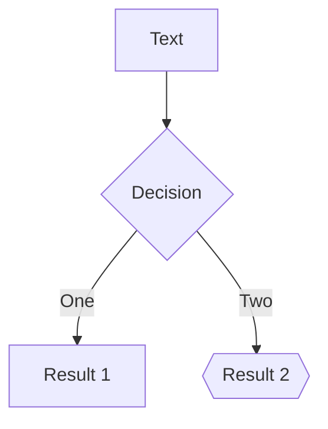
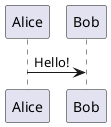

# Phase 2 showcase

Code and content

---

# Plain code

```ts
const o = { a: 1 }; // {{ not }} bound, @if too
function add(a: number, b: number) {
  return a + b;
}
```

Inline `{{ x }}` stays text.

---

# Line numbers, start line, max height

```ts {*}{lines:true,startLine:5}
function add(a: number, b: number) {
  return a + b;
}
const c = add(1, 2);
```

```ts {2}{maxHeight:'60px'}
const a = 1;
const b = 2;
const c = 3;
const d = 4;
const e = 5;
const f = 6;
```

---

# Static and stepped highlights

```ts {2,3}
const a = 1;
const b = 2;
const c = 3;
const d = 4;
```

```ts {1|2-3|4|all}
const a = 1;
const b = 2;
const c = 3;
const d = 4;
```

<div v-click id="after-code">after the code</div>

---

# Snippets

<<< ./snippets/snippet.ts#greet ts {1|2}

<<< @/snippets/snippet.ts {*}{lines:true}

---

# Code group

::code-group

```sh [npm]
npm i slide-ng
```

```sh [yarn]
yarn add slide-ng
```

::

---

# Magic move

````md magic-move
```js {*|1|2-3}
let count = 1
function add() {
  count++
}
```

```ts {*}{lines:true}
let count: number = 1
const add = () => count += 1
console.log(add())
```
````

<div v-click id="after-magic">after magic</div>

---

# Math

Inline $\sqrt{3x-1}+(1+x)^2$ and a price of $5 and $10 stay text, `$HOME` too.

$$
\begin{aligned}
a &= {{b}} \\
c &= d
\end{aligned}
$$

$$ {1|2|all}
\begin{aligned}
\nabla \cdot \vec{E} &= \frac{\rho}{\varepsilon_0} \\
\nabla \cdot \vec{B} &= 0 \\
\nabla \times \vec{E} &= -\frac{\partial\vec{B}}{\partial t}
\end{aligned}
$$

---

# Diagrams



<mermaid id="direct" code="pie title Pets&#10;&quot;Dogs&quot; : 3&#10;&quot;Cats&quot; : 2" />


